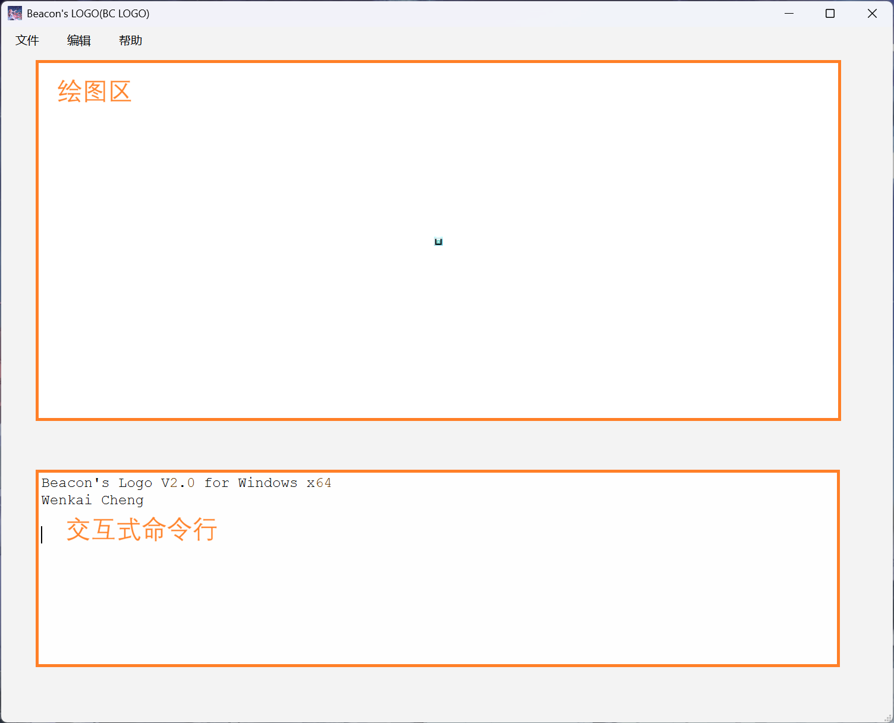

# BC LOGO（Beacon's LOGO）

BC LOGO 是一个用 **Qt 6 / C++17** 重写的 PC Logo 风格解释器。它保留了“海龟画图”的经典学习方式，同时把解释器拆成 Lexer → AST → 树遍历解释器，并提供过程、递归、变量、`OUTPUT` 返回值和可测试的绘图接口。



> 界面由菜单栏、绘图区和交互式命令行（听者 / Listener）组成。图中红色标注来自旧版帮助，仅用于说明区域。

## 特性

- 海龟（信标）绘图：前进、后退、转向、抬笔/落笔、颜色、线宽、坐标定位、清屏/清除/回家。
- 过程定义、参数、递归、重定义；用户过程既能当命令，也能在表达式里当 operation。
- `OUTPUT` / `OP` 返回值，支持 `PRINT DOUBLE 5`、递归阶乘等写法。
- 原版 Logo 风格变量：`:X` 取值，`"X` 字面量，裸词 `X` 表示过程/命令调用。
- `MAKE` / `LOCALMAKE`，支持动态作用域和局部变量遮蔽。
- 控制结构：`REPEAT`、`IF`、`IFELSE`、`WHILE`、`STOP`。
- 数学/逻辑：`SIN`、`COS`（角度制）、`RANDOM`、`AND`、`OR`、比较与四则运算。
- 文件加载、过程定义保存、画布导出 JPEG。
- 自带编辑器：保存、撤销、剪切、复制、粘贴。
- 71 项核心单元测试 + 10 万次随机输入 fuzz + 22 个端到端语料。

## 快速开始

在听者中逐行输入，每行按回车执行：

```logo
CS
REPEAT 4 [FD 100 RT 90]
```

画一个带参数的正方形过程：

```logo
TO SQUARE :N
  REPEAT 4 [FD :N RT 90]
END
SQUARE 80
```

变量：

```logo
MAKE "STEPS 60
REPEAT 6 [FD :STEPS RT 60]
PRINT :STEPS
```

返回值：

```logo
TO DOUBLE :N
  OUTPUT :N * 2
END
PRINT DOUBLE 5
```

最后一段会输出 `10`。

> 旧版 `help.docx` 里的 `MAKE X 10`、`PRINT X`、`FD X` 等写法已经不再使用。现在变量必须写 `:X`，字面量写 `"X`，裸词表示过程调用。

## 语法速查

| 写法 | 含义 | 例子 |
|---|---|---|
| `FD`、`REPEAT`、`SQUARE` | 命令/过程调用 | `FD 100` |
| `:X` | 变量 `X` 的值 | `PRINT :X` |
| `"HELLO` | 词字面量 `HELLO` | `PRINT "HELLO` |
| `123`、`1.5`、`.5`、`1e3` | 数字 | `FD 1.5` |
| `[...]` | 命令块 | `REPEAT 4 [FD 10 RT 90]` |
| `( ... )` | 表达式分组/跨行 | `PRINT (2 + 3) * 4` |
| `;` | 注释到行尾 | `FD 100 ; 前进` |

完整规则、优先级和每条命令的参数见 **[docs/logo-reference.md](docs/logo-reference.md)**。

## 界面与菜单

- **文件**
  - **新建文件**：打开编辑器，新建 `.lgo` 文件。
  - **打开文件**：用编辑器打开 `.lgo` 文件。
  - **加载文件**：立即执行 `.lgo` 文件中的代码。
  - **保存**：把当前所有过程定义保存为 `.lgo` 文件（不保存变量值、画布和命令历史）。
  - **导出图片**：把当前画布保存为 JPEG。
- **编辑**
  - **清空**：清空听者。
  - **全选**：全选听者内容。
- **帮助**
  - **使用帮助**：打开随程序部署的 `help.pdf`。
  - **关于**：显示版本和作者信息。

编辑器工具栏提供保存、撤销、剪切、复制、粘贴；快捷键为 `Ctrl+S`、`Ctrl+Z`、`Ctrl+X`、`Ctrl+C`、`Ctrl+V`。编辑器只负责编辑/保存，代码需要通过“加载文件”或听者执行。

### 听者输入

- 每行按回车执行一条指令。
- 输入 `TO 过程名 ...` 后进入定义模式，窗口底部显示 `Definition Mode`；继续输入过程体，最后输入 `END`。
- 听者按单行输入设计。跨行的方括号块建议写在 `.lgo` 文件里再加载；文件模式支持跨行块和跨行表达式。

## 构建

要求：**Qt 6**（开发环境使用 6.7.3 MinGW 64-bit）和 C++17 编译器。

用 Qt Creator 打开 [BC_LOGO.pro](BC_LOGO.pro)，选择 Desktop Qt 6.7.3 MinGW 64-bit kit，直接 Run。

命令行构建（MinGW）：

```powershell
qmake BC_LOGO.pro
mingw32-make -j4
```

独立分发时需要部署 Qt DLL 和平台插件：

```powershell
C:\Qt\6.7.3\mingw_64\bin\windeployqt.exe --no-translations `
    build\Desktop_Qt_6_7_3_MinGW_64_bit-Debug\debug\BC_LOGO.exe
```

详见 [docs/build-and-run.md](docs/build-and-run.md)。

## 测试

```powershell
powershell -ExecutionPolicy Bypass -File tests\run_all.ps1
```

包含：

- `CoreTest`：71 项单元测试；
- `FuzzTest`：固定种子 10 万条随机源码，Lexer/Parser 不崩溃；
- `corpus`：22 个端到端脚本，比较终态、画布 SHA-1 和听者输出。

只跑单元/fuzz：

```powershell
powershell -ExecutionPolicy Bypass -File tests\run_all.ps1 -SkipCorpus
```

CI 配置见 [.github/workflows/ci.yml](.github/workflows/ci.yml)：Ubuntu 上构建 app 和测试并运行单元/fuzz；语料基线在 Windows 本地跑。

## 项目结构

```text
core/           Lexer、AST、Parser、Interpreter、Engine（只依赖 QtCore）
qtconsole.*     Console → myListener
qtplotter.*     Plotter → PaintArea
mainwindow.*    主窗口、菜单、文件加载/保存
editor.*        代码编辑器
mylistener.*    听者与语法高亮
tests/          单元测试、fuzz、语料
tools/          dump_ast、run_logo
docs/           设计文档、命令参考、行为变更
```

## 文档

本 README 与 [命令与语法参考](docs/logo-reference.md) 由旧版 `help.docx` 重整，
并同步到当前 `:X` / `"X` 语法。旧帮助中的无冒号变量、无引号颜色等写法请勿继续使用。

- [命令与语法参考](docs/logo-reference.md)
- [Parser 设计](docs/parser.md)
- [AST 设计](docs/ast.md)
- [Interpreter 设计](docs/interpreter.md)
- [构建与运行](docs/build-and-run.md)
- [有意行为变更](docs/behavior-changes.md)
- [测试说明](tests/README.md)

## 已知限制

- 值只有数字和词；暂不支持列表、数组和带空格的字符串。
- `WAIT` 语法保留，但当前版本直接返回，不真正等待。
- `HOME` 当前会无条件画线，即使处于抬笔状态。
- 不支持 `|带 空格 的词|` 写法。
- 听者按单行输入设计；跨行块请用 `.lgo` 文件。
- “保存”只保存过程定义，不保存全局变量、画布和听者历史。
- 画布语料哈希依赖 Windows/Qt 的离屏渲染，Linux CI 不跑语料图片对比。
- 帮助菜单仍打开 `help.pdf`；Markdown 文档用于仓库阅读。

## 作者与致谢

- 作者：**beacon_cwk**、DeepSeek v4.1。
- 本项目是对 PC Logo / MSWLogo 等经典实现的复刻，仅用于学习交流。
- LOGO 语言由 Seymour Papert 等人于 20 世纪 60 年代在 MIT 设计，强调通过海龟绘图帮助初学者理解编程。
